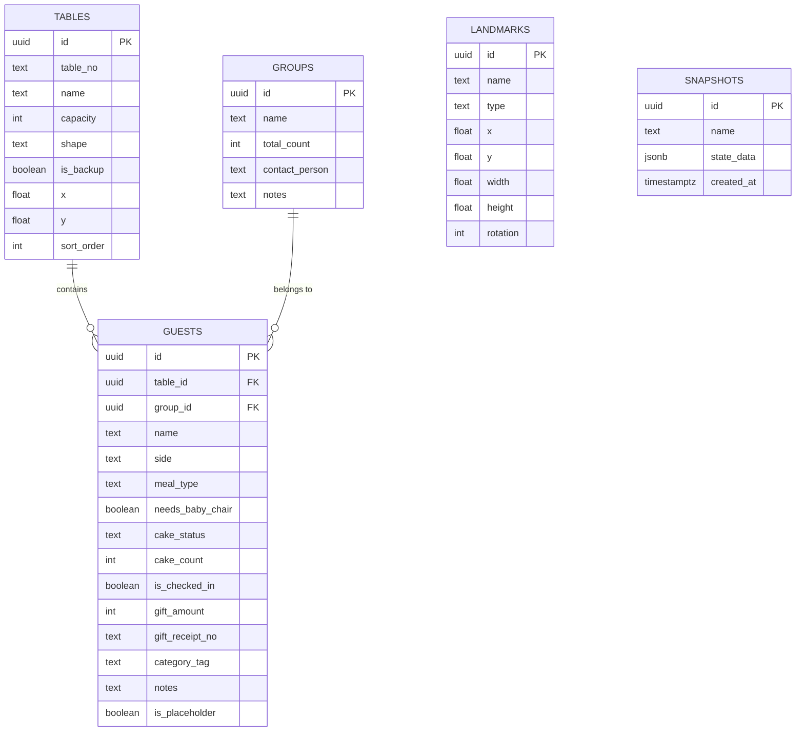

# OpenSpec: 資料模型與 Supabase 結構 (Data Model & Schema)

## 1. 實體關聯圖 (ER Diagram)



---

## 2. PostgreSQL DDL 建表指令碼 (適用於 Supabase SQL Editor)

```sql
-- 啟用 UUID 擴展
CREATE EXTENSION IF NOT EXISTS "uuid-ossp";

-- 1. 桌位資料表 (tables)
CREATE TABLE IF NOT EXISTS tables (
    id UUID PRIMARY KEY DEFAULT uuid_generate_v4(),
    table_no TEXT NOT NULL,                -- 桌號 (如 "1", "2", "主桌")
    name TEXT DEFAULT '',                  -- 桌名/備註 (如 "男方大學同學", "女方至親")
    capacity INT NOT NULL DEFAULT 10,      -- 容納人數 (預設 10，主桌可調為 12)
    shape TEXT NOT NULL DEFAULT 'circle',  -- 'circle' (圓桌) | 'rect' (長條桌)
    is_backup BOOLEAN NOT NULL DEFAULT false, -- 是否為預備桌 (備桌)
    x FLOAT NOT NULL DEFAULT 100.0,        -- 2D 畫布 X 座標
    y FLOAT NOT NULL DEFAULT 100.0,        -- 2D 畫布 Y 座標
    sort_order INT NOT NULL DEFAULT 0,
    created_at TIMESTAMPTZ DEFAULT NOW(),
    updated_at TIMESTAMPTZ DEFAULT NOW()
);

-- 2. 家庭/同行群組資料表 (groups)
CREATE TABLE IF NOT EXISTS groups (
    id UUID PRIMARY KEY DEFAULT uuid_generate_v4(),
    name TEXT NOT NULL,                    -- 群組名稱 (如 "陳小明一家")
    total_count INT NOT NULL DEFAULT 1,    -- 該組總人數配額
    contact_person TEXT,                   -- 主要聯絡人姓名
    notes TEXT,
    created_at TIMESTAMPTZ DEFAULT NOW()
);

-- 3. 賓客資料表 (guests)
CREATE TABLE IF NOT EXISTS guests (
    id UUID PRIMARY KEY DEFAULT uuid_generate_v4(),
    table_id UUID REFERENCES tables(id) ON DELETE SET NULL, -- 所屬桌次 (NULL 代表未安排)
    group_id UUID REFERENCES groups(id) ON DELETE SET NULL, -- 所屬家庭群組
    name TEXT NOT NULL,                                     -- 賓客姓名 (若未知則為佔位名如 "陳小明眷屬 #1")
    side TEXT NOT NULL DEFAULT 'groom',                     -- 'groom' (男方) | 'bride' (女方) | 'mutual' (共同) | 'staff' (工作人員)
    meal_type TEXT NOT NULL DEFAULT 'meat',                 -- 'meat' (葷食) | 'vegan' (全素) | 'vegetarian' (蛋奶素) | 'kid' (兒童餐) | 'special' (特殊)
    needs_baby_chair BOOLEAN NOT NULL DEFAULT false,        -- 是否需要兒童餐椅
    cake_status TEXT NOT NULL DEFAULT 'none',               -- 'none' (不需領取) | 'unclaimed' (未領取) | 'claimed' (已領取)
    cake_count INT NOT NULL DEFAULT 0,                      -- 需領喜餅盒數 (通常以家庭或女方親友為單位，預設 0 或 1)
    is_checked_in BOOLEAN NOT NULL DEFAULT false,           -- 當天報到狀態
    gift_amount INT DEFAULT NULL,                           -- 禮金金額 (選填)
    gift_receipt_no TEXT DEFAULT NULL,                      -- 紅包收據編號 (選填)
    category_tag TEXT DEFAULT '',                           -- 關係標籤 (如 "大學同學", "前同事", "親戚長輩")
    notes TEXT DEFAULT '',                                  -- 備註 (飲食禁忌、過敏等)
    is_placeholder BOOLEAN NOT NULL DEFAULT false,          -- 是否為家庭群組的虛擬佔位席
    created_at TIMESTAMPTZ DEFAULT NOW(),
    updated_at TIMESTAMPTZ DEFAULT NOW()
);

-- 4. 會場地標元件 (landmarks)
CREATE TABLE IF NOT EXISTS landmarks (
    id UUID PRIMARY KEY DEFAULT uuid_generate_v4(),
    name TEXT NOT NULL,                    -- 地標名稱 (如 "舞台", "進場紅毯", "收禮桌", "樑柱")
    type TEXT NOT NULL,                    -- 'stage' | 'aisle' | 'reception' | 'pillar' | 'audio' | 'door'
    x FLOAT NOT NULL DEFAULT 200.0,
    y FLOAT NOT NULL DEFAULT 50.0,
    width FLOAT NOT NULL DEFAULT 240.0,
    height FLOAT NOT NULL DEFAULT 80.0,
    rotation INT NOT NULL DEFAULT 0,       -- 旋轉角度 (0, 90, 180, 270)
    created_at TIMESTAMPTZ DEFAULT NOW()
);

-- 5. 快照版本資料表 (snapshots)
CREATE TABLE IF NOT EXISTS snapshots (
    id UUID PRIMARY KEY DEFAULT uuid_generate_v4(),
    name TEXT NOT NULL,                    -- 快照備忘名稱 (如 "匯入前備份", "調動前版本A")
    state_data JSONB NOT NULL,             -- 包含當前 tables, guests, groups, landmarks 的完整 JSON 快照
    created_at TIMESTAMPTZ DEFAULT NOW()
);

-- 索引優化
CREATE INDEX IF NOT EXISTS idx_guests_table_id ON guests(table_id);
CREATE INDEX IF NOT EXISTS idx_guests_group_id ON guests(group_id);
CREATE INDEX IF NOT EXISTS idx_guests_name ON guests(name);
CREATE INDEX IF NOT EXISTS idx_guests_side ON guests(side);

-- 開啟 Supabase Realtime 廣播
ALTER PUBLICATION supabase_realtime ADD TABLE tables;
ALTER PUBLICATION supabase_realtime ADD TABLE guests;
ALTER PUBLICATION supabase_realtime ADD TABLE groups;
ALTER PUBLICATION supabase_realtime ADD TABLE landmarks;

-- 開放公開操作 RLS (依照使用者要求：直接透過專屬網址免密碼存取)
ALTER TABLE tables ENABLE ROW LEVEL SECURITY;
ALTER TABLE groups ENABLE ROW LEVEL SECURITY;
ALTER TABLE guests ENABLE ROW LEVEL SECURITY;
ALTER TABLE landmarks ENABLE ROW LEVEL SECURITY;
ALTER TABLE snapshots ENABLE ROW LEVEL SECURITY;

CREATE POLICY "Public full access to tables" ON tables FOR ALL USING (true) WITH CHECK (true);
CREATE POLICY "Public full access to groups" ON groups FOR ALL USING (true) WITH CHECK (true);
CREATE POLICY "Public full access to guests" ON guests FOR ALL USING (true) WITH CHECK (true);
CREATE POLICY "Public full access to landmarks" ON landmarks FOR ALL USING (true) WITH CHECK (true);
CREATE POLICY "Public full access to snapshots" ON snapshots FOR ALL USING (true) WITH CHECK (true);
```

---

## 3. 本地離線暫存資料結構 (IndexedDB / LocalStorage Schema)

為了確保在地下室訊號微弱時依然能維持現場招待操作，前端本地維護一組 Sync Queue：

```typescript
interface OfflineSyncAction {
  id: string;             // UUID
  action: 'UPDATE_GUEST' | 'CHECK_IN' | 'CLAIM_CAKE' | 'RECORD_GIFT';
  guestId: string;
  payload: Partial<Guest>;
  timestamp: number;
}
```
- 每次招待操作先立即寫入前端記憶體與 IndexedDB，並在背景以佇列重試寫入 Supabase。
- 恢復網路連線 (`window.addEventListener('online')`) 時自動遍歷佇列，依序發送並清空。
