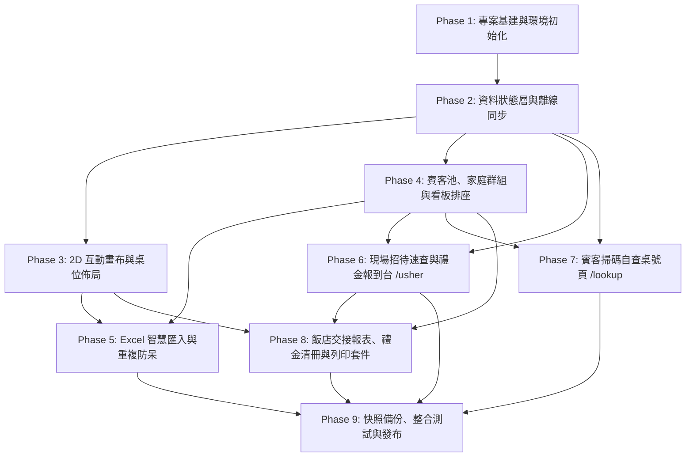

# OpenSpec: 開發實作任務拆解 (Implementation Tasks)

> 版本：1.0.0  
> 建立日期：2026-11-16  
> 關聯規格：[project.md](file:///c:/Users/09017/Documents/antigravity/SeatingPlan/openspec/project.md) | [specs/data-model.md](file:///c:/Users/09017/Documents/antigravity/SeatingPlan/openspec/specs/data-model.md) | [specs/functional-specs.md](file:///c:/Users/09017/Documents/antigravity/SeatingPlan/openspec/specs/functional-specs.md)

---

## 任務相依架構圖 (Task Dependency Graph)

---

## 階段一：專案基建與環境初始化 (Phase 1: Project Setup)

- [ ] **1.1 前端工程初始化**
  - [ ] 初始化 Vite + React + TypeScript 專案。
  - [ ] 安裝並配置 Tailwind CSS、PostCSS 與 Lucide React 圖標庫。
  - [ ] 設定 React Router DOM 支援多視圖路由 (`/`, `/usher`, `/lookup`)。
- [ ] **1.2 Supabase 客戶端整合**
  - [ ] 安裝 `@supabase/supabase-js`。
  - [ ] 建立 `src/lib/supabase.ts`，配置環境變數讀取 (`VITE_SUPABASE_URL`, `VITE_SUPABASE_ANON_KEY`) 與公開預設 fallback。
  - [ ] 驗證資料庫連線與 Realtime WebSocket 訂閱通道。

---

## 階段二：資料層、狀態管理與離線快取 (Phase 2: State & Offline Sync)

- [ ] **2.1 TypeScript 領域模型定義**
  - [ ] 定義 `Table`, `Guest`, `Group`, `Landmark`, `Snapshot` 核心型別 (`src/types/index.ts`)。
  - [ ] 定義飲食習慣、男女所屬、喜餅狀態、地標類別之 Enum / Union Types。
- [ ] **2.2 全域狀態中心 (Wedding Context / Store)**
  - [ ] 實作全域資料快取與 CRUD Actions (桌位、賓客、家庭、地標)。
  - [ ] 監聽 Supabase Realtime 變更（INSERT / UPDATE / DELETE）實現跨裝置無縫同步。
  - [ ] 實作頂部指標計算器（總人數、已排人數、葷素比、兒童餐/兒童椅需求、喜餅發放進度、禮金總額）。
- [ ] **2.3 本地離線暫存與自動同步隊列 (Offline Fallback)**
  - [ ] 封裝 IndexedDB / LocalStorage 快取儲存。
  - [ ] 建立離線操作佇列 (`OfflineSyncAction`)。
  - [ ] 註冊 `online` 事件監聽器，網路恢復時自動批次回寫 Supabase 並顯示狀態指示燈。

---

## 階段三：2D 互動畫布與會場佈局 (Phase 3: 2D Canvas & Layout)

- [ ] **3.1 畫布基礎引擎**
  - [ ] 實作畫布平移 (Pan) 與雙向無段縮放 (Zoom In/Out，支援滑鼠滾輪與觸控手勢)。
  - [ ] 繪製淡色網格輔助點 (Dot Grid) 與磁吸網格切換 (Snap to Grid)。
  - [ ] 提供「重置視角」、「縮放控制鈕」與快捷工具列。
- [ ] **3.2 桌位實體節點 (Table Node Component)**
  - [ ] 實作圓桌與長條桌視覺渲染，顯示桌號、桌名與即時人數環狀進度條。
  - [ ] 支援滑鼠/觸控自由拖拉更新 X, Y 座標，放開自動同步儲存。
  - [ ] 實作軟性超額警示（當入座人數 > 容納上限時，呈現呼吸亮紅外框與 `11/10 ⚠️` 標籤）。
  - [ ] 支援正式桌 vs 預備桌（備桌）狀態切換與虛線框視覺區隔。
  - [ ] 點擊桌位展開「桌內賓客清單與快速調整彈窗」。
- [ ] **3.3 會場幾何地標元件 (Landmark Components)**
  - [ ] 提供「舞台」、「紅毯走道」、「正門入口」、「樑柱遮蔽」、「收禮接待桌」、「音控台」預設地標。
  - [ ] 地標支援拖曳定位、自訂長寬尺寸與 90 度旋轉。

---

## 階段四：賓客池、家庭群組與排座操作 (Phase 4: Guests & Board View)

- [ ] **4.1 未指派賓客抽屜 (Unassigned Pool)**
  - [ ] 側邊欄常駐未分配桌位的賓客卡片清單。
  - [ ] 支援關鍵字即時模糊搜尋（姓名/備註）與多維度過濾（男方/女方/葷素/標籤）。
- [ ] **4.2 家庭群組機制 (Household / Family Groups)**
  - [ ] 支援新增家庭（輸入總人數，自動為未具名成員產生「眷屬 #1」佔位席）。
  - [ ] 支援「整家一鍵排入指定桌次」與拆解單人拖拉功能。
- [ ] **4.3 看板式雙模式切換 (Board View)**
  - [ ] 提供類似 Trello 之桌次卡片網格視圖。
  - [ ] 實作 HTML5 / dnd-kit 拖放，可將賓客在桌子間或賓客池間隨意拖拉。
- [ ] **4.4 生活圈分類標籤 (Tags) 與批次排桌**
  - [ ] 賓客支援自由添加關係標籤（如「大學同學」、「新娘閨蜜」）。
  - [ ] 提供「多選同標籤賓客一鍵批次指派至某桌」捷徑操作。

---

## 階段五：Excel 智慧匯入與重複名單防呆 (Phase 5: Excel Integration)

- [ ] **5.1 範本下載與檔案解析**
  - [ ] 整合 SheetJS (`xlsx`)，支援下載標準 Excel 空白範本檔。
  - [ ] 解析上傳之 `.xlsx` / `.csv` 檔案，支援欄位模糊別名對齊（姓名/葷素/男女性別/攜伴人數等）。
- [ ] **5.2 增量新增不覆蓋 (Append-only Import)**
  - [ ] 確保匯入操作不刪除、不覆蓋現有已排桌位資料。
- [ ] **5.3 重複名單偵測與預覽對照視窗**
  - [ ] 自動將匯入名單與現有名冊進行同名（與電話/備註）比對。
  - [ ] 出現疑似重複時，於預覽視窗以黃色醒目標記。
  - [ ] 提供使用者針對各筆重複資料選擇：(A) 當作同名同姓新增 (B) 略過 (C) 合併更新。
  - [ ] 產出匯入統計報表 Toast（成功新增 X 人、略過 Y 人、合併 Z 人）。

---

## 階段六：現場招待速查報到台 (`/usher`) (Phase 6: Usher Reception View)

- [ ] **6.1 行動端/平板最佳化觸控介面**
  - [ ] 大字號極速搜尋框，輸入字首即刻篩選。
  - [ ] 清晰顯示賓客所屬「桌號、桌名、葷素狀態、兒童椅、喜餅需求」。
- [ ] **6.2 一鍵快速核銷**
  - [ ] 超大綠色「一鍵報到」觸控按鈕，點擊即標記出席。
  - [ ] 女方親友卡片顯示「🎁 領取喜餅 (X 盒)」，點擊一鍵核銷。
- [ ] **6.3 收禮台禮金記帳選填功能**
  - [ ] 折疊式禮金卡片，支援點擊展開輸入「紅包收據編號」與「禮金金額」。
  - [ ] 金額即時統計至總禮金收入。
- [ ] **6.4 斷線防呆指示燈**
  - [ ] 頂部常駐連線狀態標籤（🟢 線上同步中 / 🟡 離線暫存模式）。

---

## 階段七：賓客現場自查桌號頁面 (`/lookup`) (Phase 7: Guest Self-Service)

- [ ] **7.1 迎賓自查介面**
  - [ ] 典雅婚宴歡迎視覺，免登入。
  - [ ] 輸入姓名進行查詢。
- [ ] **7.2 隱私隔離防護**
  - [ ] 查詢結果僅回傳該姓名之桌號、桌名、葷素與會場平面位置指引。
  - [ ] 後端與前端過濾器嚴格屏蔽他人名單、聯絡電話與禮金資料。
- [ ] **7.3 迎賓立牌 QR Code 產生器**
  - [ ] 在主控台提供一鍵產生自查頁面之 QR Code 圖檔，方便新人下載印製門口立牌。

---

## 階段八：報表匯出與列印套件 (Phase 8: Reporting & Print Suite)

- [ ] **8.1 飯店會館交接專用總表匯出 (.xlsx)**
  - [ ] 匯出各桌桌號、桌名、容納數、實到數、葷食數、全素數、兒童餐數、兒童椅張數、備桌標記與特殊飲食備註。
- [ ] **8.2 禮金清冊 (禮金簿) 匯出 (.xlsx)**
  - [ ] 匯出包含序號、賓客姓名、所屬方、紅包編號、禮金金額之標準禮金簿。
- [ ] **8.3 喜餅發放清冊匯出 (.xlsx)**
  - [ ] 匯出女方/需領餅親友之領取盒數、領取狀態與時間。
- [ ] **8.4 2D 畫布高解析度圖片匯出與 A4 列印**
  - [ ] 整合 `html-to-image`，支援將目前排座平面圖匯出為 PNG 圖片。
  - [ ] 撰寫 `@media print` 樣式，支援瀏覽器直接列印整潔無雜訊的桌次清冊與地圖。

---

## 階段九：快照備份、整合測試與部署交付 (Phase 9: Snapshots & Delivery)

- [ ] **9.1 快照備份與版本還原 (Snapshot Management)**
  - [ ] 支援一鍵備份當前全部桌位、賓客、地標狀態至 `snapshots` 資料表。
  - [ ] 支援快照歷史列表檢視與「一鍵還原至指定快照」。
- [ ] **9.2 跨裝置連動與壓力測試**
  - [ ] 驗證多裝置同時開著主控台與 `/usher` 模式時的 Realtime WebSocket 雙向更新。
  - [ ] 模擬斷網狀態下的報到領餅，驗證重連後資料無衝突上傳。
  - [ ] 測試 300+ 賓客與 35 桌之 2D 畫布渲染流暢度 (60 FPS)。
- [ ] **9.3 交付文檔與部署指引**
  - [ ] 撰寫專案根目錄 `README.md`，包含 Vercel / Netlify 一鍵部署步驟與 Supabase 環境變數設定教學。
